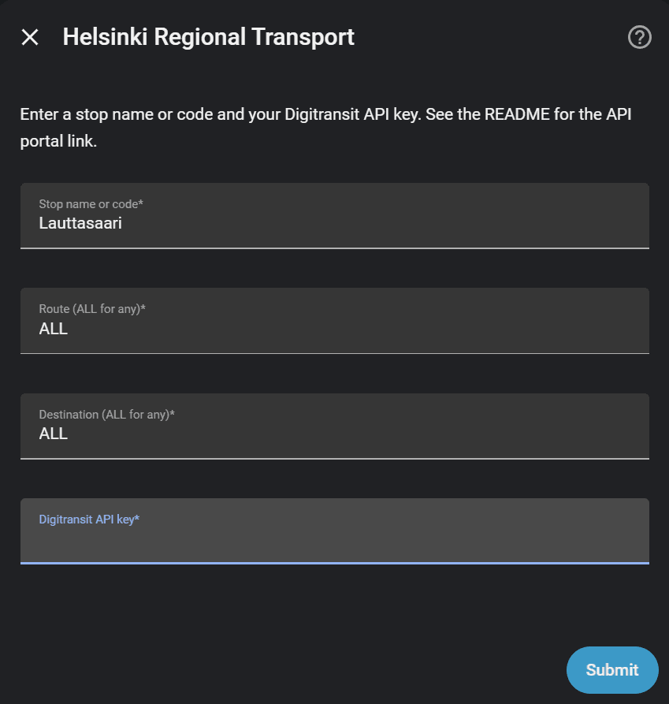
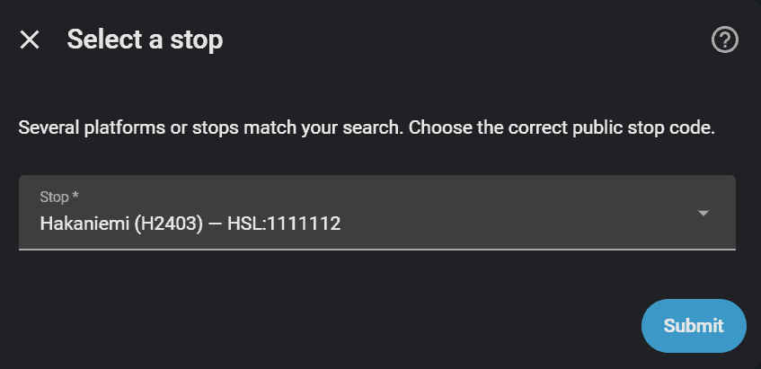
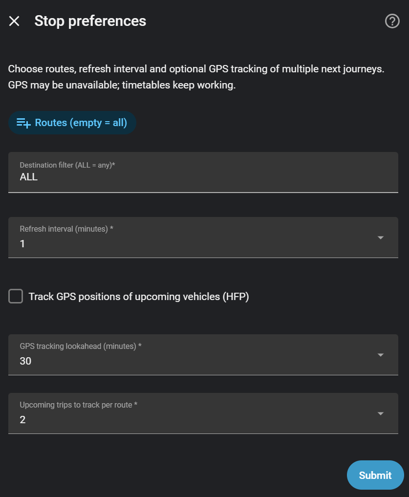
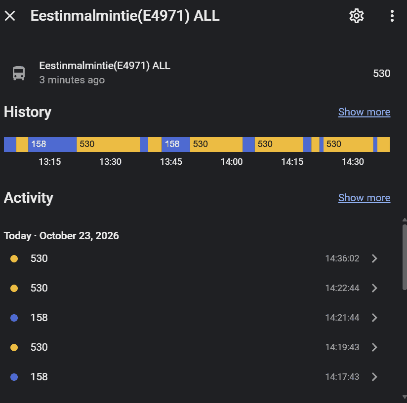

# Helsinki Regional Transport (HSL HRT)

Home Assistant custom integration for upcoming HSL departures at a selected stop using
[Digitransit Routing v2](https://digitransit.fi/en/developers/apis/1-routing-api/).

**Release history:** [CHANGELOG.md](CHANGELOG.md).

## Home Assistant compatibility

**Minimum supported Home Assistant Core: 2026.10.2 (Python 3.14).**
This is the version used by the real Home Assistant integration test suite
in GitHub Actions. Earlier Home Assistant versions are not supported by
the current HSL HRT integration. HACS checks this requirement when installing
or updating the integration. This compatibility requirement is separate
from the HSL HRT integration's version number.

## Installation

In HACS, add `https://github.com/fursov/hslhrt-hass-custom` as a custom
**Integration** repository. Install it, restart Home Assistant, then open
**Settings → Devices & services** and add **Helsinki Regional Transport**.

For manual installation, copy `custom_components/hslhrt/` into
`<HA configuration>/custom_components/hslhrt/` and restart Home Assistant.

You need a Digitransit API subscription key from
https://portal-api.digitransit.fi/ . The key is sent in the
`digitransit-subscription-key` header. Existing configurations imported
from v0.3.5 require reauthentication but should not be deleted.

## Stop setup and filtering

Enter a stop name, public stop code (`E4971`, `E4972`) or GTFS ID
(`HSL:...`). Name search shows a selection when multiple platforms are
returned. The code search verifies the exact stop against Routing v2.

*Initial configuration (example: Lauttasaari; API key intentionally left blank):*



*When more than one platform matches, choose the public stop code and GTFS ID
(example: Hakaniemi):*



Under **Configure**, select one or more routes and a destination filter
(`ALL` means all). A nonempty route selection takes precedence over
destination. The Routing API polling interval can be set to 1, 2, 3, 5, 10,
15 or 30 minutes. Existing entries keep their original filters until changed.

For compact setup, the GPS tracking lookahead (15–90 minutes) and number of
journeys per route (1–5) are **drop-down selectors**, rather than long radio
lists. Tracking is optional and disabled by default.

The **Upcoming departures shown when tapping a map stop** preference
is configured separately for each stop entry (1–10, default **5**).
It controls how many departures appear in the stop marker's More Info
dialog. No extra Digitransit API requests are needed.

<details>
<summary>Show current compact Options Flow (Home Assistant 2026.10)</summary>



The image shows the default GPS lookahead (30 minutes) and journeys per route
(2). The earlier pre-release screenshot with radio-button lists remains
available in the [historical UI archive](docs/legacy-ui-examples.md).

</details>

**Languages:** The setup and options dialogs are available in English and
Finnish (*suomi*). Select Finnish in your Home Assistant user profile's
**Language** setting. Your existing stop IDs, entity IDs, and API filters
remain unchanged when you switch languages. Restart Home Assistant and
refresh the browser after updating the integration if translations are cached.

## Sensors

Each stop/route entry has three standard sensors:

| Sensor | Meaning |
| --- | --- |
| Route | Route number of the next arriving bus/tram, with legacy `ROUTE`, `DESTINATION`, `ARRIVAL TIME`, `ROUTES` and stop attributes |
| Next arrival | Timezone-aware datetime of the next arrival |
| Minutes until arrival | Rounded-up minutes until the next arrival |

The legacy `ROUTES` attribute excludes the first arrival and is capped at
20 further departures. The modern `departures` attribute includes the first
10. Both attributes are refreshed locally every minute as arrivals expire.
These sensors remain available when GPS tracking is disabled or HFP is offline.

<details>
<summary>Show an example of the route sensor's History view</summary>



This is the built-in **History / Activity** view of the route sensor, showing
how the *next route number* changes. It is **not a timetable card** and does
not show every upcoming departure; use the `departures` attribute or the
dashboard examples below for a timetable.

</details>

## Optional HFP vehicle tracking

The integration can track **multiple next journeys per route at the configured
stop**, not just the first bus overall. Open **Configure** and enable
*Track GPS positions*. Choose a horizon (15–90 minutes, default 30) and a
maximum number of journeys per public route (1–5, default 2).

Once enabled, an additional **Tracked vehicles** sensor appears:

- Numeric state: number of upcoming journeys with fresh GPS coordinates.
- `selected_journeys`: number of eligible trips whose GTFS journey identity
  can be matched to HFP.
- `vehicles`: bounded list of planned journeys and their GPS when available.
  Each row includes route, transport mode when available, arrival, direction,
  trip start, operating day and `gps_available`. The `latitude`, `longitude`, speed and heading appear
  only when the HFP position is fresh.
- `hfp_connected`: whether the public MQTT broker is currently connected.

Tracking uses TLS with the public `mqtt.hsl.fi:8883` broker, separately from
your own Home Assistant / Zigbee2MQTT broker. It does **not** require another
Digitransit API key. No GPS data is fabricated: if there is no matching HFP
vehicle or the last position is older than 90 seconds, the journey stays in
the list but `gps_available` is false. The integration limits subscriptions
to 32 exact route/direction/start combinations per stop. Updates of HA
entities are throttled to approximately five seconds.

Some timetable journeys lack the GTFS metadata required for exact matching;
they remain in the original timetable but are omitted from HFP selection.
GPS positions are exposed on Home Assistant's Map card when fresh HFP data is available (see below).

## Live vehicles and configured stops on the map

With HFP tracking enabled on a configured stop, the integration now publishes
**temporary** `geo_location` entities for selected upcoming journeys that
currently have fresh HFP GPS coordinates. No marker is shown when the vehicle
is not known or its last position is older than 90 seconds.

Add a built-in **Map** card and select the `hslhrt` source under
**Geolocation sources**. YAML equivalent:

```yaml
type: map
geo_location_sources:
  - source: hslhrt
    label_mode: attribute
    attribute: marker_label
  - source: hslhrt_stops
    label_mode: icon
auto_fit: true
```

The map shows vehicles from **all configured stops with HFP tracking enabled**,
plus a small circle icon at every configured stop with valid coordinates
(including stops where HFP tracking is switched off). Stop locations come
from the existing Digitransit timetable response, requiring no additional
API calls. Stops use the separate `hslhrt_stops` geolocation source and are
shown independently of GPS availability. Each vehicle
marker label defaults to an emoji and public route number (for example
`🚌 530`, `🚋 7`, `🚇 M1`, `🚆 I`, or `⛴ 19`), where Digitransit
provides a recognized `vehicle_mode`. Unknown types display only the route
number rather than a guessed vehicle type. The `marker_label` and
`vehicle_mode` attributes are also available for automations. Other
attributes include destination, stop code, arrival time, operator/vehicle,
position timestamp, heading and speed. The vehicle source is `hslhrt`;
the stop source is `hslhrt_stops`.
Both use Home Assistant's standard marker size: the stop's
`mdi:circle-small` icon appears *inside* the standard marker, not as an
arbitrarily sized dot. Since they are real geolocation entities, configured
stops may also show automatically on the built-in Map dashboard; no changes
are made to that dashboard's configuration. Separate entries for the same
physical stop can overlap or be grouped by the map.

Tapping a configured-stop marker in `ha-map-card` (using its default
`tap_action: more-info`) opens Home Assistant's standard More Info dialog.
The marker exposes `next_departure_1` through `next_departure_N`,
with local Helsinki arrival time, route and destination; `N` is the
per-stop **Upcoming departures shown when tapping a map stop** preference.
The default is 5 (configurable from 1 to 10 under **Configure**).
For example, an attribute may read `16:58 · 530 → Matinkylä`. When
a departure is on a later local date, the day/month is also displayed.
These are the **next arrivals after applying that entry's route and
destination filters**, not necessarily all routes serving a physical stop.
Only already-fetched departures are shown, with local minute-boundary
updates; expired entries disappear even between API polls. The dialog
displays attributes, not a custom table or popup card.

Vehicle markers **update in place** as new coordinates arrive and are completely
removed when their journey leaves the selected horizon, the GPS becomes stale,
the configuration unloads or GPS tracking is switched off. These temporary
entities deliberately have no permanent registry entries and cannot be pinned
individually before a vehicle has been observed. The existing route and ETA
sensors continue to function independently from HFP.

## Dashboard examples

The examples below use a stop configured as **Eestinmalmintie (E4971)** with
the **ALL** routes option. Replace each sample `sensor.eestinmalmintie_e4971_all`
entity ID (and its suffixes) with the actual entities shown under
**Settings → Devices & services → Helsinki Regional Transport → Entities**
or **Developer Tools → States**. Home Assistant generates IDs from entity names;
they can differ after renaming, selecting routes, or restoring old entries.
The `_next_arrival`, `_minutes_until_arrival`, and `_tracked_vehicles`
suffixes refer to *unique IDs*, not guaranteed literal entity IDs.
Do not create additional template sensors just to obtain these values.

These examples use **built-in Home Assistant cards** and require no
custom Lovelace cards.

### 1. Next route and arrival (Entities Card)

Three sensors are created by default per configured stop entry.

```yaml
type: entities
title: Eestinmalmintie (E4971)
show_header_toggle: false
entities:
  - entity: sensor.eestinmalmintie_e4971_all
    name: Next route
  - entity: sensor.eestinmalmintie_e4971_all_next_arrival
    name: Next arrival
  - entity: sensor.eestinmalmintie_e4971_all_minutes_until_arrival
    name: Minutes until arrival
```

The next-arrival sensor has Home Assistant's timestamp device class; it
already handles day boundaries and local-time presentation. All three timetable
sensors (next route, next arrival and remaining minutes) are **re-evaluated
locally at each minute boundary** using the most recently fetched departures.
Expired trips disappear and the next known trip becomes active even between
Digitransit polls. The configured polling interval (1–30 minutes) still
controls **only** HTTP requests to Digitransit, not these local updates.
No extra API calls or HFP MQTT operations are made by the minute timer. When
all fetched departures expire, values become unknown until new data arrives.

### 2. Route and stop details (Entities Card)

This example uses the **legacy attributes**, which are still provided
on the main route sensor. Attribute names are case-sensitive.

```yaml
type: entities
title: Eestinmalmintie details
entities:
  - type: attribute
    entity: sensor.eestinmalmintie_e4971_all
    attribute: STOP NAME
    name: Stop
  - type: attribute
    entity: sensor.eestinmalmintie_e4971_all
    attribute: STOP CODE
    name: Stop code
  - type: attribute
    entity: sensor.eestinmalmintie_e4971_all
    attribute: ROUTE
    name: Next route
  - type: attribute
    entity: sensor.eestinmalmintie_e4971_all
    attribute: DESTINATION
    name: Destination
  - type: attribute
    entity: sensor.eestinmalmintie_e4971_all
    attribute: ARRIVAL TIME
    name: Arrival (local HH:MM:SS)
```

The main sensor state is already the next route number; the attributes
`ROUTE`, `DESTINATION`, and `ARRIVAL TIME` are absent if there is no
upcoming departure. The legacy `ROUTES` list *excludes* this first departure.

### 3. Next arrival with a readable countdown (Markdown Card)

No `platform: template` sensors are needed. Use the real minutes-until-arrival
sensor rather than subtracting clock-time strings; the timestamp sensor handles
overnight departures correctly.

```yaml
type: markdown
title: Next HSL departure
content: |
  
  
  
  
  
  
  **Route {{ trip.route }} → {{ trip.destination }}**

  Expected: **{{ as_local(arrival).strftime('%d.%m %H:%M') if arrival else 'unknown' }}**

  Time remaining: **{{ states(minutes_sensor) }} min**
  
  No upcoming departures, or data is currently unavailable.
  
```

### 4. Table of upcoming departures (Markdown Card)

Use the structured `departures` attribute, which **includes** the nearest
departure and is limited to 10. The legacy `ROUTES` attribute starts with
the *second* departure, so using that list would omit the next bus.

```yaml
type: markdown
title: Eestinmalmintie departures
content: |
  
  
  | Route | Destination | Arrival | Data |
  | :---- | :---------- | :------ | :--- |
  
  
  | {{ trip.route }} | {{ trip.destination }} | {{ as_local(dt).strftime('%d.%m %H:%M') if dt else '—' }} | {{ 'Realtime' if trip.realtime else 'Scheduled' }} |
  
  
  No upcoming departures, or data is currently unavailable.
  
```

Timestamps in `departures[*].arrival_datetime` are ISO 8601 UTC values;
`as_local` converts them to your Home Assistant timezone. Blank/unknown
departures produce an explanatory message rather than a template error.

### 5. Optional HFP tracking status (Entities Card)

Only available after **Configure → Track GPS positions** is enabled. A value
of `0` means zero tracked journeys currently have fresh GPS; check
`hfp_connected` for broker connectivity, and `selected_journeys` for
the number of journeys eligible for matching.

```yaml
type: entities
title: HSL live vehicles
entities:
  - entity: sensor.eestinmalmintie_e4971_all_tracked_vehicles
    name: Vehicles with fresh GPS
  - type: attribute
    entity: sensor.eestinmalmintie_e4971_all_tracked_vehicles
    attribute: hfp_connected
    name: HFP MQTT connected
  - type: attribute
    entity: sensor.eestinmalmintie_e4971_all_tracked_vehicles
    attribute: selected_journeys
    name: Selected journeys
```

The `vehicles` attribute contains individual journey records with
`gps_available`, and fresh `latitude`/`longitude` only when known.
Availability of coordinates is not guaranteed for every upcoming journey.

### 6. Live vehicle locations and configured stops (Map Card)

Stops appear as circle-icon markers as soon as their coordinates are
available from Digitransit, even if no live GPS positions are available.
Vehicles appear when HFP tracking is enabled and GPS is fresh. This map
includes all configured stops and all selected vehicles across entries,
not just the one used in the dashboard examples.

```yaml
type: map
geo_location_sources:
  - source: hslhrt
    label_mode: attribute
    attribute: marker_label
  - source: hslhrt_stops
    label_mode: icon
auto_fit: true
```

To show **only vehicle route numbers**, change `attribute: marker_label`
to `attribute: route` in the YAML. Remove the `hslhrt_stops` source
from the card to hide stops without affecting any HA entities. To show only the mode-dependent MDI icon,
replace the `label_mode` and `attribute` lines with `label_mode: icon`.
The built-in Map Card does not render separate icon-and-text controls in the
same marker; `marker_label` is a simple combined text alternative. Stop
markers use `label_mode: icon` with the `mdi:circle-small` icon.

Vehicle markers are temporary; they disappear if GPS ages beyond 90 seconds
or a journey is no longer selected. Configured-stop markers are independent
of HFP and remain visible while valid stop coordinates are available.
If no vehicles are shown, the timetable sensors may still be working normally.
No extra MQTT integration in Home Assistant is required.

### Historical screenshots

The four original UI screenshots are preserved in
[Historical dashboard screenshots](docs/legacy-ui-examples.md). They document
the earlier integration, **not** the current 2026.10 dashboard. The old
template-sensor and entity-filter examples are intentionally not recommended:
they are unnecessarily complicated and can be wrong around midnight.
The current configuration, stop-selection, options and route-sensor history
screenshots above were captured in an actual Home Assistant instance. They
show different example stops and are not a guarantee of exact entity names
or map availability on your installation.

## Development and tests

Run the lightweight unit tests in a Python 3.13 environment:

```sh
python -m pip install pytest ruff aiohttp voluptuous
python -m pytest -q tests --ignore=tests/integration
```

Run tests against real Home Assistant Core in a separate Python 3.14
environment (no live HSL calls):

```sh
python -m pip install -r requirements-ha-tests.txt
python -m pytest -q -p pytest_homeassistant_custom_component tests/integration
```

These must run in **separate processes**, because the fast tests use
`homeassistant` module stubs. CI runs both suites, Hassfest and HACS.
The Home Assistant integration-test baseline is pinned for repeatability.

## Original Author
Anand Radhakrishnan [@anand-p-r](https://github.com/anand-p-r)
