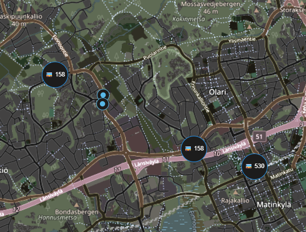
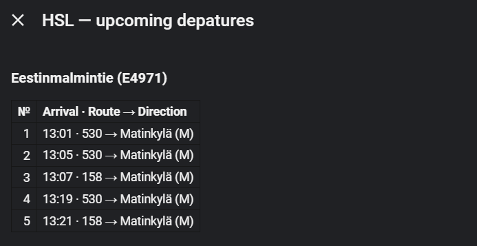

# Interactive HSL map: ha-map-card, auto-entities and Browser Mod

This guide documents a practical Home Assistant setup combining **ha-map-card**
(for the transport map), **auto-entities** (for automatically selecting live
vehicle and stop entities) and **Browser Mod** (for a custom departures table
when a stop marker is clicked). It is based on a working dashboard configuration
and uses existing HSL HRT v0.9.2 entity attributes.

## Requirements

Install and configure the [HSL HRT integration](installation.md), with
[stops and optional GPS tracking](configuration.md). To reproduce the map
and stop dialogs, also install these frontend extensions:

- [ha-map-card](https://github.com/nathan-gs/ha-map-card)
- [auto-entities](https://github.com/thomasloven/lovelace-auto-entities)
- [Browser Mod](https://github.com/thomasloven/hass-browser_mod)

Live vehicles appear only for selected trips with fresh HFP GPS coordinates;
stop circles are available even if vehicle tracking is disabled.

## 1. A transport map with distinct stop and vehicle markers

Create a dashboard view for the map. A **Panel** view is useful if you want
the map to fill the available width; it accepts one top-level card.
Add a **Manual** card with the following configuration:

```yaml
type: custom:auto-entities
card:
  type: custom:map-card
  cluster_markers: false
  card_size: 7
card_param: entities
show_empty: true
filter:
  include:
    - domain: geo_location
      attributes:
        source: hslhrt_stops
      options:
        display: icon
        icon: mdi:circle
        size: 20
        color: '#58B8E8'
        z_index_offset: 1
        tap_action:
          action: more-info
    - domain: geo_location
      attributes:
        source: hslhrt
      options:
        display: attribute
        attribute: marker_label
        size: 42
        color: '#2196F3'
        z_index_offset: 100
        tap_action:
          action: more-info
```



*Example: live buses and configured stop platforms near Matinkylä. The map displays
vehicles and small circular markers for stop platforms.*

This arrangement gives stops **small light-blue circles** and vehicles
**larger blue labels** (for example, `🚌 530`). `z_index_offset: 100` keeps
vehicle markers above the stop markers if they overlap, and
`cluster_markers: false` avoids collapsing vehicles and stops into clusters.

`auto-entities` selects entities by their `source` attribute and injects
them into the `entities` parameter of `ha-map-card` through
`card_param: entities`. You do not need to enumerate temporary vehicle IDs
or edit the map whenever a new bus appears. `show_empty: true` leaves the
map visible even if no vehicles currently have fresh GPS.

The data sources are independent:

- `hslhrt_stops`: one `geo_location` entity for each configured stop
  with known coordinates, including stops without active vehicle tracking.
- `hslhrt`: temporary `geo_location` entities for selected HFP journeys
  with fresh GPS positions. `marker_label` holds the transport symbol and
  public route number when available.

Both marker types retain `tap_action: more-info`. The **next step** makes
those clicks display a useful table for the configured stops, instead of
the default attribute list.

## 2. Browser Mod popup for upcoming departures

Create a **separate dashboard subview** to hold the Browser Mod
`custom:popup-card` configuration. In that subview add a **Manual** card
using this YAML:

```yaml
type: custom:popup-card
target:
  entity_id:
    - geo_location.hslhrt_stop_aaaaaaaaaaaaaaaa
    - geo_location.hslhrt_stop_bbbbbbbbbbbbbbbb
title: HSL — upcoming departures
card:
  type: markdown
  content: |
    
    
    
    

    ### {{ name }} ({{ code }})

    
    | No. | Arrival / departure · Route → Direction |
    |---:|:---|
    
    
    | {{ i }} | {{ label }} |
    
    
    No upcoming departures.
    
adaptive: false
adaptive_allow_mode_change: false
popup_card_all_views: true
```



*Example: clicking a stop circle opens the upcoming-departures table for
Eestinmalmintie (E4971), with arrival times, routes and destinations.*

**Replace the two illustrative `geo_location.hslhrt_stop_…` IDs** with
the actual stop entity IDs from **Developer Tools → States** or
**Settings → Devices & services → Helsinki Regional Transport → Entities**.
List every configured stop for which you want this popup. Unlike the
map's `auto-entities` filter, Browser Mod's `target.entity_id` list in
this example is explicit, so newly added stop entries need to be added here.

The `popup_card_all_views: true` setting makes this popup card apply to
the dashboard's other views as well, even though you placed the configuration
card in its own subview. Place the subview in the **same dashboard** as the
map. Browser Mod must be installed and loaded by the viewing browser.

### Why `more_info.entityId` is a string

Keep the exact text:

```jinja2

```

Browser Mod replaces the literal placeholder `more_info.entityId` in
the popup card's string values with **the ID of the entity that was
clicked**, before Home Assistant renders the Markdown card. This allows
the same popup template to work for all stops listed in `target.entity_id`.
Do not replace it with `states('more_info.entityId')` or a fixed stop ID.

The popup reads already available stop attributes:

- `stop_name` and `stop_code` for the heading;
- `upcoming_departures_count` for the current number of rows;
- `next_departure_1`, `next_departure_2` and so on, up to the configured
  limit (**1–10, default 5**).

The backward-compatible `next_departure_N` values contain local clock times,
route and destination (for example, `16:58 · 530 → Matinkylä`). The optional
`next_departure_N_display` values additionally show `4 min (realtime)`
when a fresh arrival prediction is available at a through stop, or a local
clock time / departure time at origins and when no fresh prediction exists.
The popup uses the new field when available and falls back to the old field. The table is populated
from the integration's existing coordinator data, so opening the popup makes
**no new Digitransit requests**. Rows are refreshed as the stop's attributes
are updated. All example UI text is in English; customize the title, table headers,
and empty-state message for your Home Assistant language as needed.

### What happens when clicking markers?

1. Click a **blue stop circle** on the map: `more-info` is intercepted by
   Browser Mod for a matching `target.entity_id`, and the custom timetable
   Markdown table appears.
2. Click a **vehicle marker**: no stop popup matches that entity, so
   its ordinary More Info opens, with destination, speed, heading and the
   last reported position. One HFP journey has **one marker**, even when
   several configured stops track it; the marker survives while at least
   one stop is still watching that journey.
3. Click an unlisted stop: it uses the ordinary More Info dialog until
   you add that stop's entity ID to the popup configuration.

### Distance and the next tracked stop

In Home Assistant geolocation, the built-in `distance` is the straight-line
distance **from the Home Assistant Home coordinates to the vehicle**.
It is not the distance to an HSL stop, so the integration preserves it.

The vehicle's More Info also exposes:

- `tracked_stop_codes`: all configured stops currently tracking the
  exact journey (e.g. `E4971`, `E4972`);
- `next_tracked_stop`: the first *future configured stop* in timetable
  order (e.g. `E4972` after passing `E4971`);
- `distance_to_next_tracked_stop_km`: straight-line vehicle-to-stop
  distance, measured in kilometers, or `null` if there is no future
  tracked stop or valid stop location.

**Next tracked stop is not necessarily the very next physical stop along
the route**. Unconfigured intermediate stops are not represented. This
distance is not a road-routing distance and is not used for the upstream
Digitransit realtime arrival estimate.

## Optional refinements

Adjust the circle size, colors and `z_index_offset` independently for
stops and vehicles. If many items overlap, try `cluster_markers: true`;
the example keeps it false for clarity.

For a dedicated map in the sidebar, add a dashboard view and select a
recognizable icon such as `mdi:bus-multiple`. Use a Panel view for a
wide map; a Sections view may constrain the card width.

## Additional screenshots (optional)

The live map and stop popup screenshots above illustrate the complete setup.
Further screenshots could show the Browser Mod popup-card editor in its
separate subview or the same popup on a mobile device.

## Limitations

- The custom-map YAML is based on a working user configuration and is
  checked for YAML structure in CI. CI cannot render third-party frontend
  cards or verify the appearance of the popup on a particular browser.
- Vehicle telemetry does **not** generate its own arrival estimate.
  The popup uses Digitransit realtime predictions when fresh, while origin
  stops show departures without an approaching-vehicle ETA. See
  [Realtime arrival semantics](realtime-arrivals.md).
- Keep `popup_card_all_views` enabled only if the same popup behavior is
  desired on all views of this dashboard.
