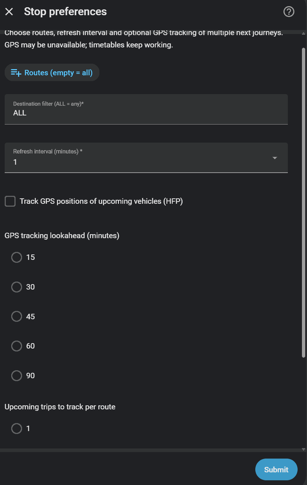

# Historical dashboard screenshots (legacy integration)

These images came from the original HSL HRT README and are retained for
historical reference **only**. They have **not** been visually re-verified
against Home Assistant 2026.10.2, and they do **not** represent screenshots of
the current v0.8.0 entities, Options Flow or live HFP map.

The old accompanying YAML used legacy template sensors and an entity-filter
wrapper. Some of those templates incorrectly handle time after midnight.
Do **not** copy the old YAML. For supported examples use the
[Dashboard examples](dashboard-examples.md).

## 1. List of routes and stops (historical)

## 2. Stop details and arrival attributes (historical)

## 3. Manually constructed next-route templates (historical)

## 4. Manually constructed timetable (historical)

These images are kept unchanged to preserve authorship and history. They
must not be treated as instructions for the present release.

## 5. Pre-release 0.8.0 Options Flow (superseded)

This image was captured from an earlier pre-release build in which HFP
tracking lookahead and journeys-per-route settings used long radio-button
lists. The final 0.8.0 Options Flow uses **compact drop-downs** instead.
See [configuration guide](configuration.md) for the supported
settings and values.
